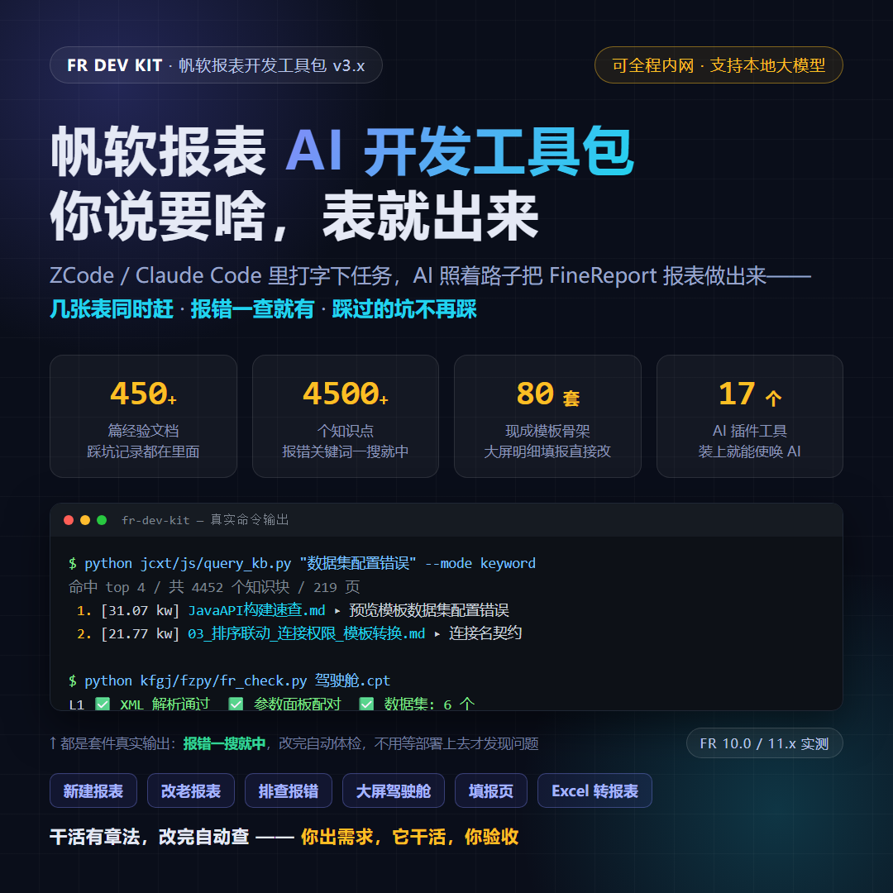
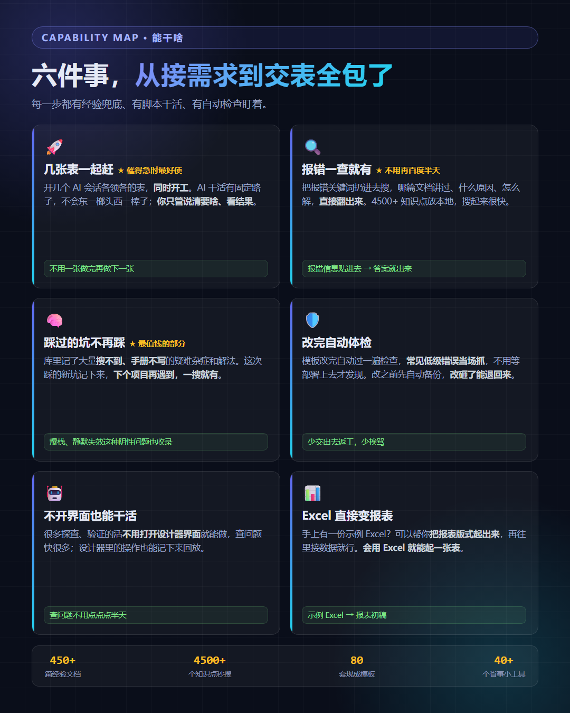
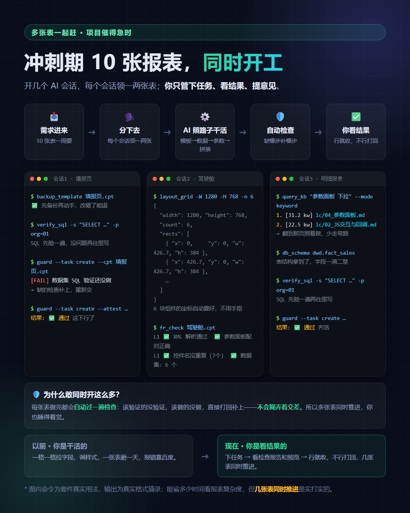
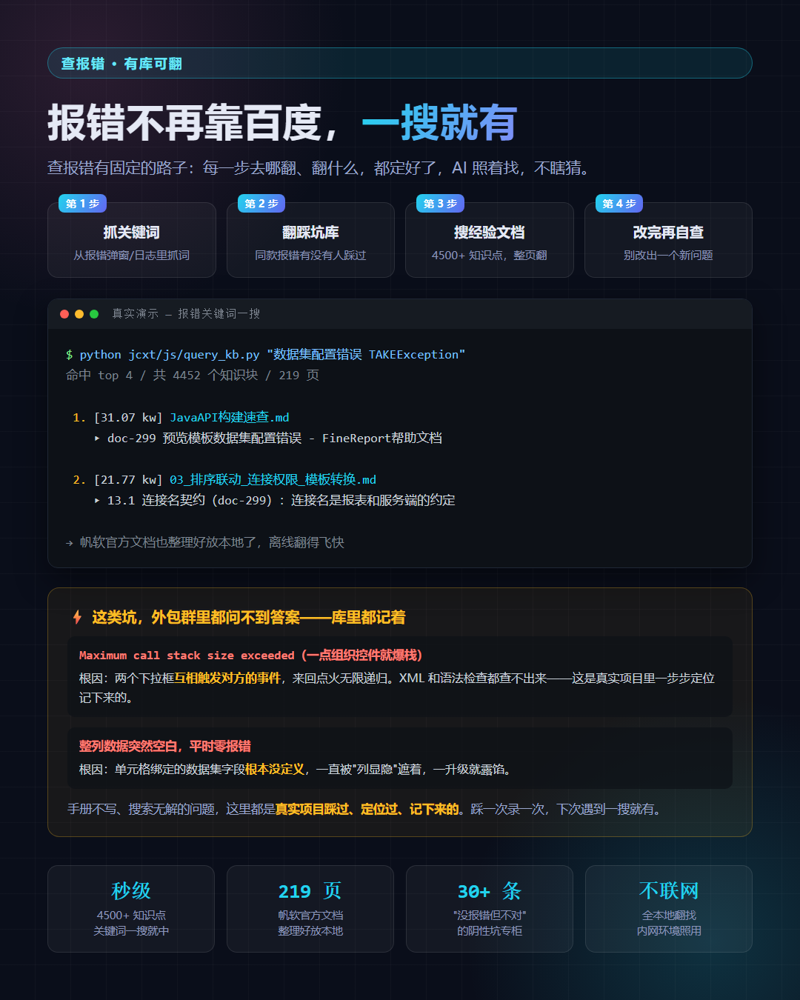
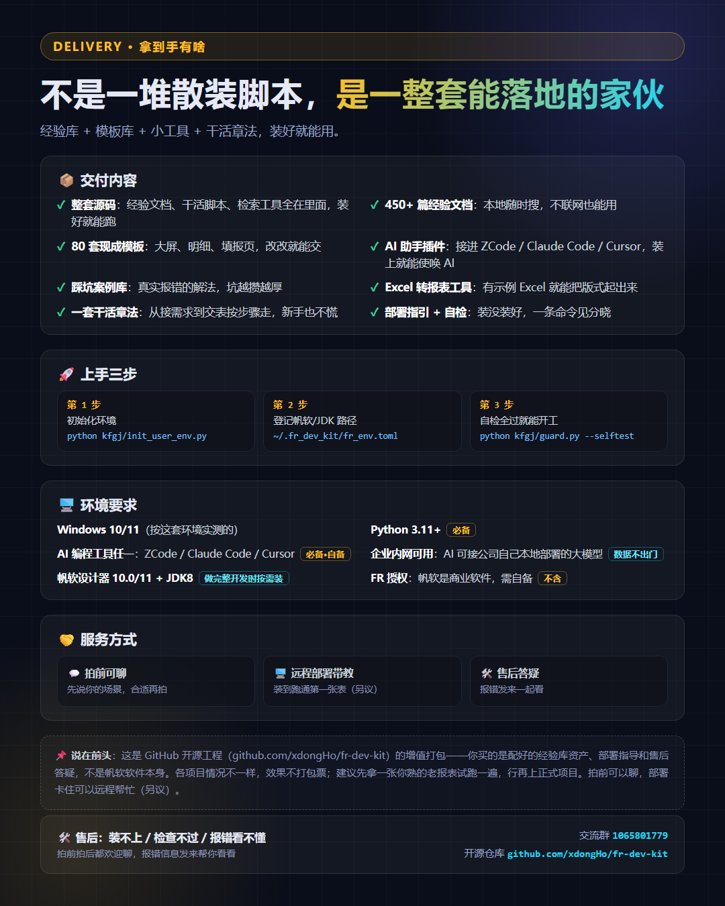

# FR 报表开发工具包（fr-dev-kit）

> 帆软 FineReport 报表的 AI 开发工作底座 · 开源 comm 版
> **👉 QQ 交流群：1065801779**

你说要啥，AI 照着路子把报表做出来，做完自动检查一遍，你只管看结果、提意见。项目赶工期，几张表可以同时开工。

这套东西配齐了四样：**经验文档库**（放本地，随时搜）、**80 套现成模板**（大屏/明细/填报直接改）、**一堆省事小工具**（算布局、验 SQL、模板体检这些体力活都自动化了）、**AI 插件**（接进 ZCode / Claude Code / Cursor 就能使唤 AI 干活）。AI 那一头也可以接**企业自己本地部署的大模型**——整套跑在内网里，数据和模板不出门。



## 它能干什么

六件事，从接需求到交表全包：几张表一起赶、报错一查就有、踩过的坑不再踩、改完自动体检、不开界面也能干活、Excel 直接变报表。每一步都有经验兜底、有脚本干活、有自动检查盯着。



### 项目催得急？几张表同时开工

开几个 AI 会话，每个会话领一两张表，同时开工——不用一张做完再做下一张。AI 干活有固定路子，不会东一榔头西一棒子；每张表做完自动过一遍检查，缺哪步补哪步，不会糊弄着交差。你的角色从干活的，变成看结果的。



### 报错不再靠百度

把报错关键词扔进去搜，哪篇文档讲过、什么原因、怎么解，直接翻出来。4500+ 个知识点和帆软官方文档都整理好放在本地，搜起来很快，不联网也能用。库里还记了大量真实项目踩过的坑——包括"没报错但功能就是不对"的阴性问题（比如一点控件就爆栈、整列数据突然空白这种搜不到答案的）。这次踩的新坑记下来，下个项目再遇到，一搜就有。



### 拿到手有啥

不是一堆散装脚本，是一整套能落地的家伙：整套源码、450+ 篇经验文档、80 套模板、AI 助手插件、踩坑案例库、Excel 转报表工具、一套干活章法文档。装没装好，一条命令见分晓。



## 快速开始（三步）

```bash
python kfgj/init_user_env.py      # 1. 初始化用户环境（目录骨架+路径探测登记）
# 2. 登记 FR/JDK 路径：~/.fr_dev_kit/fr_env.toml（检测不对直接改这个文件）
python kfgj/guard.py --selftest   # 3. 环境/断链/契约自检，全 PASS 即就绪
```

日常怎么用（检索知识、调工具、走流程）、开发规范与全局铁律，见 [AGENTS.md](AGENTS.md)——它是本套件的唯一入口。

## 环境要求

- Windows 10/11 + Python 3.11+
- AI 编程工具任一：ZCode / Claude Code / Cursor（也可接企业本地部署的大模型，全程内网可用）
- FineReport 设计器 10.0 / 11.x + JDK8：做完整开发闭环时按需安装（只做离线生成模板可不装）
- FineReport 是帆软商业软件，**本仓库不含其授权**，需自行准备

## 目录速览

| 目录 | 内容 |
|------|------|
| `ckzl/` | 参考资料：开发流程知识、工作流节点、知识库、FR Java 资料、规范铁律、模板骨架 |
| `kfgj/` | 开发工具：辅助脚本、格式化脚本、fr-agent、DSL 编译器、渲染预览、质量闸门 |
| `jcxt/` | 检索系统：本地关键词检索 + 树索引导航 + 页级阅读（零 key、零配置、零外网依赖） |
| `scwj/` | 输出产物：演示与临时落地（宣传素材也在 `scwj/营销素材/`） |
| `plugins/` | ZCode 插件：17 个 MCP 工具 + 控制台面板 |

## 说明

- 用户私有数据（备份/快照/项目经验/记忆）在 `%USERPROFILE%\.fr_dev_kit\`，不随仓库分发。
- 宣传图源文件与重渲脚本在 [`scwj/营销素材/html/`](scwj/营销素材/html)，改完 `python render.py` 重出图。
